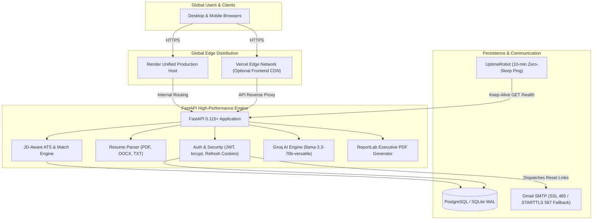

<div align="center">

# ⚡ CareerLens AI — Resumetric
### Autonomous Resume Intelligence, ATS Scoring & AI Career Acceleration Platform

[](https://resumetric-1.onrender.com)
[](https://resumetric-challengers13.vercel.app)
[](https://python.org)
[](https://fastapi.tiangolo.com)
[](https://react.dev)
[](LICENSE)

<br />

**CareerLens AI** is an enterprise-grade resume intelligence platform that bridges the gap between candidates and Applicant Tracking Systems (ATS). Using TF-IDF cosine matching, 75+ detected skill ontologies, Groq-accelerated LLMs (`llama-3.3-70b-versatile`), and deterministic heuristic engines, it delivers instant, JD-aware scoring, tailored cover letters, interactive rewrite coaching, learning roadmaps, and downloadable executive PDF reports.

[Explore Live App](https://resumetric-1.onrender.com) • [API Swagger Docs](https://resumetric-1.onrender.com/docs) • [Keep-Alive Health](https://resumetric-1.onrender.com/health) • [Deployment Guide](DEPLOYMENT.md)

</div>

---

## 🌐 Live Deployments

| Component | Provider | URL | Notes |
| :--- | :--- | :--- | :--- |
| **Primary Production (Fullstack)** | **Render** | [https://resumetric-1.onrender.com](https://resumetric-1.onrender.com) | Unified React 19 SPA + FastAPI Backend |
| **Global Edge Frontend** | **Vercel** | [https://resumetric-challengers13.vercel.app](https://resumetric-challengers13.vercel.app) | Worldwide low-latency CDN distribution |
| **REST API & Swagger Docs** | **Render** | [https://resumetric-1.onrender.com/docs](https://resumetric-1.onrender.com/docs) | Interactive OpenAPI 3.0 test console |
| **24/7 Keep-Alive Monitor** | **UptimeRobot** | [https://resumetric-1.onrender.com/health](https://resumetric-1.onrender.com/health) | Prevents service sleeping & cold starts |

---

## 🏗️ System Architecture



---

## ✨ Core Capabilities

### 1. Resume Intelligence & JD Matching
- **TF-IDF Vector Matching:** Computes mathematical cosine similarity between candidate experience and target job descriptions.
- **JD-Aware ATS Score (100 pts):**
  - **40 pts:** Structural & format hygiene (contact info, sections, bullet points, length).
  - **35 pts:** Required skill coverage (matched vs missing from JD).
  - **25 pts:** Keyword density and domain term overlap.
- **Career Domains Classification:** Evaluates candidate fit across 10 top tech domains (Full Stack, Backend, Frontend, Cloud/DevOps, Data/ML, Mobile, Security, QA, UI/UX, Product).

### 2. AI-Powered Coaching & Cover Letters
- **Groq Llama-3.3-70B Acceleration:** Ultra-low latency responses with offline heuristic fallbacks when unconfigured.
- **Interactive AI Rewrite Coach:** Tailors bullet points to highlight quantifiable business impact (STAR methodology).
- **One-Click Tailored Cover Letters:** Generates customized cover letters matched directly to the target role.
- **Technical Interview Simulator:** Surfaces domain-specific behavioral and technical interview questions with suggested answers.

### 3. Enterprise Security & Account Management
- **Strict Direct-to-Email Password Reset:** Password reset links are dispatched **strictly to the user's verified inbox** using dual-port Gmail SMTP (Port 465 SSL with automatic Port 587 STARTTLS fallback). Zero on-screen token leaks.
- **Explicit Authentication on Sign-Up:** New users register and are redirected to login with their email pre-filled to authenticate securely with their credentials.
- **Dual Token JWT Architecture:** 30-minute access tokens paired with rotating, cross-origin `httpOnly` refresh cookies (`SameSite=None` in production).

### 4. Executive Reporting & Analytics
- **Downloadable PDF Reports:** Professional ReportLab-generated analytics dossiers containing charts, ATS breakdowns, missing keywords, and learning resources.
- **Admin Dashboard:** Platform-wide telemetry, user growth trends, popular missing skills radar, and user search.

---

## 📁 Repository Directory Structure

```text
Resumetric/
├── backend/
│   ├── app/
│   │   ├── api/v1/              # REST routes (auth, analysis, career, admin, users)
│   │   ├── core/                # App config, database session, security, deps
│   │   ├── models/              # SQLAlchemy 2.0 ORM database models
│   │   ├── services/            # ATS scoring, Groq LLM, email, PDF generation
│   │   └── celery_tasks.py      # Async background processing tasks
│   ├── tests/                   # Pytest automated test suite
│   ├── main.py                  # FastAPI application entry & SPA catch-all
│   ├── requirements.txt         # Python dependencies
│   ├── seed_demo.py             # Pre-seeds demo and admin accounts
│   └── test_email.py            # SMTP diagnostic and delivery test tool
├── frontend/
│   ├── src/
│   │   ├── components/          # Reusable UI widgets & navigation
│   │   ├── context/             # Global AuthContext & session state
│   │   ├── lib/                 # Axios client & API interceptors
│   │   └── pages/               # React 19 views (Dashboard, Analyze, Auth, etc.)
│   ├── package.json             # Node dependencies (Vite, React 19, Tailwind v4)
│   └── vite.config.js           # Vite build configuration
├── DEPLOYMENT.md                # 24/7 Global production deployment manual
├── Dockerfile                   # Universal multi-stage production container
├── docker-compose.yml           # Local full-stack containerized orchestrator
├── render.yaml                  # Render Blueprint infrastructure as code
├── start-dev.bat                # 1-Click Windows Batch launcher
├── start-dev.ps1                # 1-Click PowerShell launcher
├── vercel.json                  # Vercel Edge routing configuration
├── CONTRIBUTING.md              # Contribution standards & guidelines
├── SECURITY.md                  # Security policies & vulnerability reporting
└── LICENSE                      # MIT Open Source License
```

---

## 🚀 Quick Start (Local Development)

### Option 1: 1-Click Windows Launcher
Double-click `start-dev.bat` or run:
```powershell
.\start-dev.ps1
```
This automatically boots:
- **FastAPI Backend:** [http://127.0.0.1:8000](http://127.0.0.1:8000) (Docs: `/docs`)
- **Vite React Frontend:** [http://localhost:5173](http://localhost:5173)

---

### Option 2: Cross-Platform Manual Setup

#### Prerequisites
- **Python 3.11+**
- **Node.js 20+**

#### 1. Backend Setup
```bash
cd backend
python -m venv venv

# Windows:
.\venv\Scripts\activate
# macOS/Linux:
source venv/bin/activate

pip install -r requirements.txt
python -m uvicorn main:app --reload --host 127.0.0.1 --port 8000
```

#### 2. Frontend Setup
```bash
# In a new terminal:
cd frontend
npm install
npm run dev
```

---

## 🔑 Pre-Seeded Demonstration Accounts

To immediately test all user and administrator dashboards without manual data entry:

```bash
cd backend
python seed_demo.py
```

| Account Role | Email Address | Password | Permissions & Pre-Loaded Data |
| :--- | :--- | :--- | :--- |
| **Administrator** | `admin@careerlens.ai` | `Admin@12345` | Full platform access + Global Admin Analytics (`/admin`) |
| **Demo Candidate** | `demo@careerlens.ai` | `Demo@12345` | Pre-loaded resumes, 85% ATS score, 88.5% JD match, and charts |

---

## 🧪 Testing Suite

CareerLens AI maintains end-to-end unit and integration tests across scoring algorithms, token hashing, and authentication flows:

```bash
# Execute backend test suite
python -m pytest backend/tests -v

# Verify frontend production build
npm --prefix frontend run build
```

---

## 🌐 24/7 Zero-Sleep Global Deployment

CareerLens AI is packaged to run 24/7 anywhere online without limits or cold-start sleep delays:

### 1. Render One-Click Unified Deployment (Recommended)
FastAPI bundles and serves the compiled React 19 frontend directly from `frontend/dist`.
1. Fork or push this repository to GitHub.
2. In [dashboard.render.com](https://dashboard.render.com), create a **New Blueprint** and select `render.yaml`.
3. Add your environment variables (`GROQ_API_KEY`, `SMTP_USERNAME`, `SMTP_APP_PASSWORD`).

### 2. Prevent Cold Starts (Keep-Alive Automation)
Render pauses free instances after 15 minutes of inactivity. To ensure **zero sleep forever**:
1. Create a free account at [UptimeRobot.com](https://uptimerobot.com).
2. Add a new **HTTP(s) Monitor**:
   - **URL:** `https://resumetric-1.onrender.com/health`
   - **Interval:** Every 10 minutes.
3. Your platform stays awake 24/7/365 with immediate response times.

*For complete details on Koyeb, Hugging Face Spaces, and Docker VPS deployments, see [DEPLOYMENT.md](DEPLOYMENT.md).*

---

## ⚙️ Environment Variables Reference

| Variable | Required | Description | Example / Default |
| :--- | :--- | :--- | :--- |
| `APP_ENV` | Optional | Application mode (`development` or `production`) | `production` |
| `DATABASE_URL` | Optional | Async database connection string | `sqlite+aiosqlite:///./careerlens.db` |
| `FRONTEND_URL` | Yes | Target origin for email reset & verification links | `https://resumetric-1.onrender.com` |
| `ALLOWED_ORIGINS` | Yes | Comma-separated list of allowed CORS origins | `https://resumetric-1.onrender.com,...` |
| `GROQ_API_KEY` | Optional | Groq Cloud API key for Llama-3.3-70B intelligence | `gsk_...` |
| `SMTP_HOST` | Yes | Outgoing email server | `smtp.gmail.com` |
| `SMTP_PORT` | Yes | Outgoing port (465 SSL or 587 STARTTLS) | `465` |
| `SMTP_USERNAME` | Yes | Sender email address | `you@gmail.com` |
| `SMTP_APP_PASSWORD`| Yes | 16-character Google App Password | `xxxx xxxx xxxx xxxx` |

---

## 📄 License

Distributed under the **MIT License**. See [`LICENSE`](LICENSE) for more information.

---

<div align="center">
  <sub>Built with ❤️ by <b>Mahesh Burra</b> • Empowering careers through transparent AI intelligence</sub>
</div>
